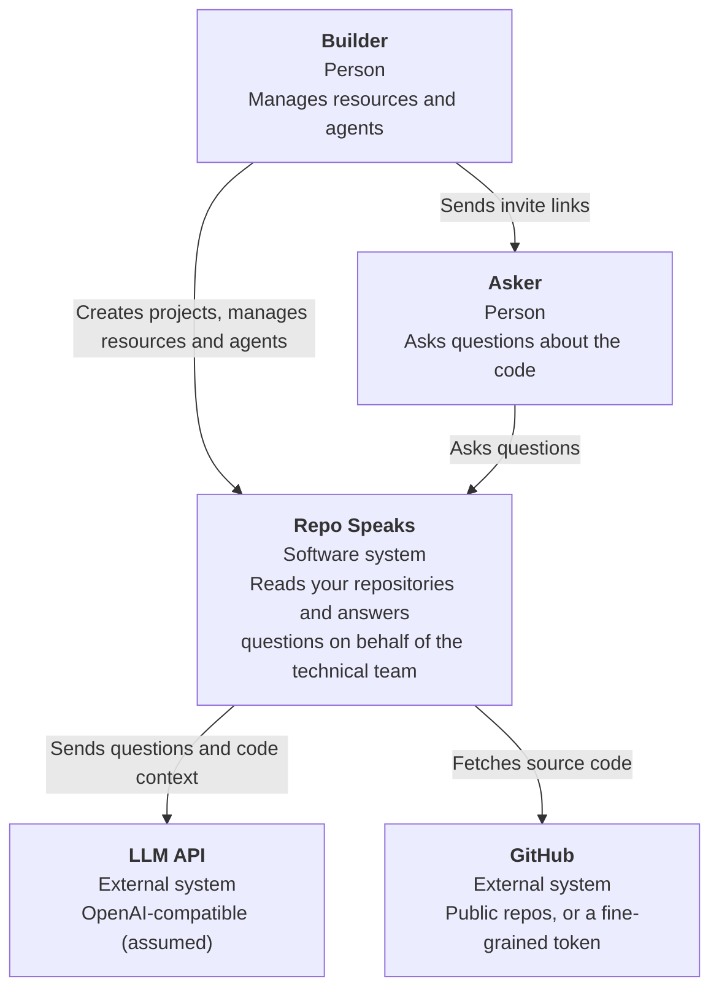
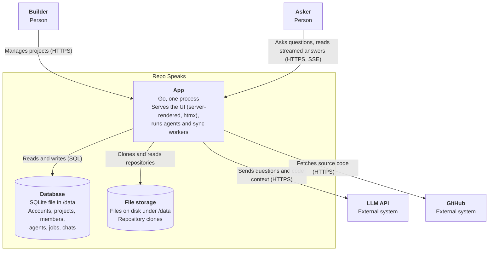
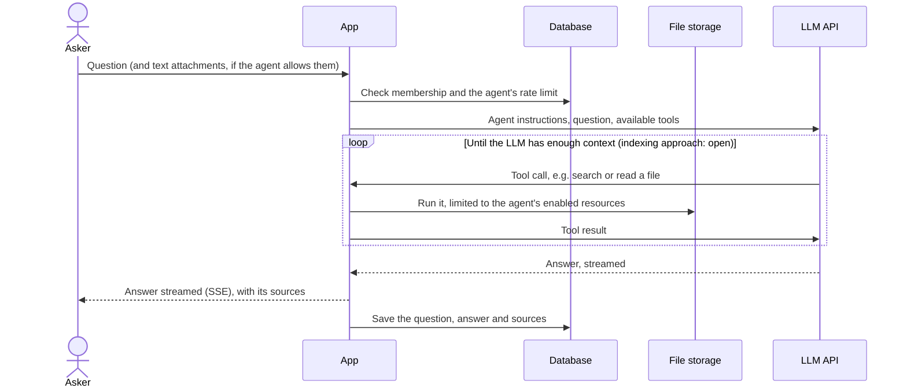
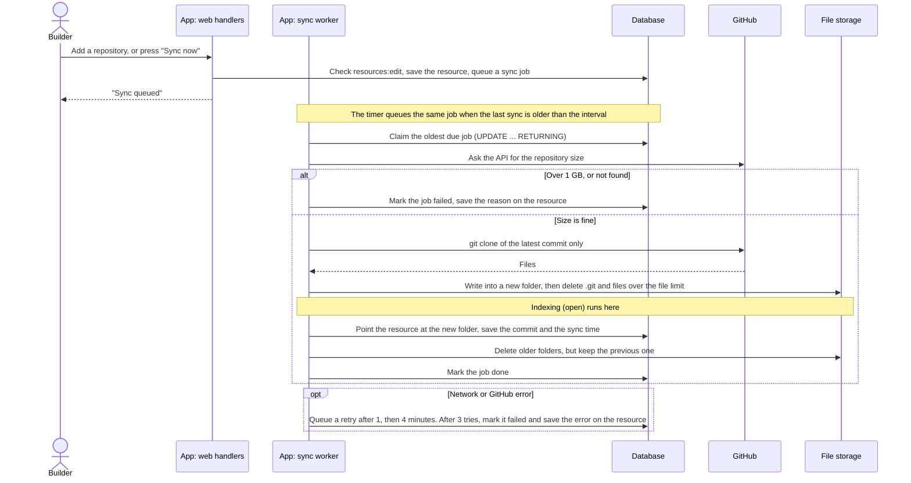
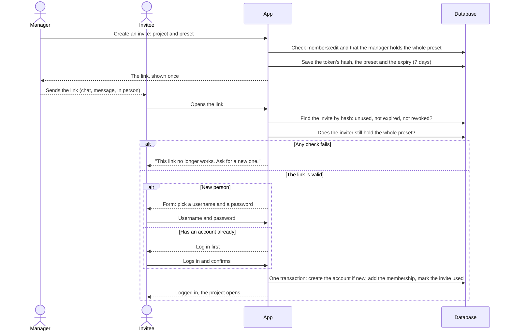
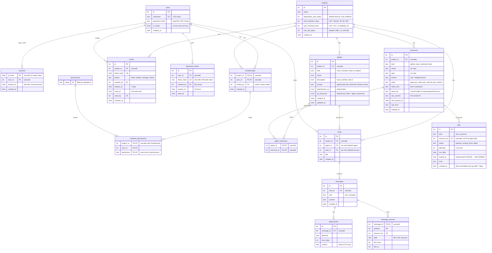
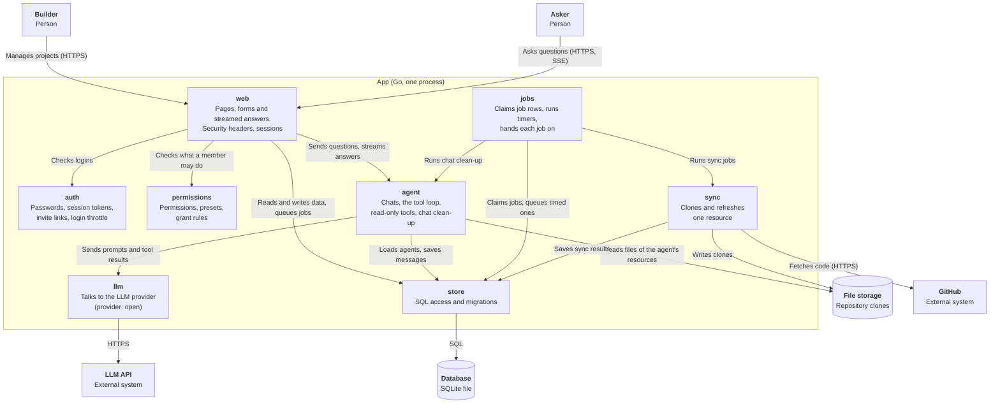

# Architecture

How Repo Speaks is built, at a high level. Terms follow the [glossary](docs/glossary.md).

> **Status:** early development. Boxes and choices marked *open* are not decided yet.

## Quality goals

In priority order. When two of them conflict, the higher one wins.

| # | Quality | Scenario |
| --- | --- | --- |
| 1 | Easy to self-host | A developer with Docker and an LLM API key gets the first answer within 15 minutes, running one container with one data folder. |
| 2 | Project isolation | Nothing from project A (no file, answer or source) ever reaches a member or agent of project B. Every route and every agent tool is covered by a test. |
| 3 | Answers you can check | Every answer lists the files it used. When the agent cannot find something, it says so instead of guessing. |

## System context



## Containers



- **One process.** The web UI, the agents and the sync workers run in one Go binary; sync workers are goroutines.
- **Jobs are database rows**, so a restart does not lose a sync in progress. There is no Redis.
- **SQLite** is the database: a file in `/data`, used from inside the Go process through a pure-Go driver.
- **One data folder** (`/data`) holds the database and the clones (`/data/repos/<project>/<resource>`). One volume to mount, one folder to back up.
- **Clone protection:** the repository size is checked before cloning (1 GB at most), only the latest commit is fetched, and files over a per-project limit (default 5 MB) are deleted from the clone.

## Main flow: an asker asks a question



The loop shows agentic search. If indexing uses embeddings instead, the App searches the index first and sends the closest pieces in one call; the rest of the flow stays the same.

## Sync flow: a repository is brought up to date

A sync starts in three ways: a builder adds a repository, a builder presses "Sync now", or the project's timer fires (every 6 hours by default; off, 1, 6 or 24 hours). All three add the same job row.



- **One open job per resource.** Pressing "Sync now" twice does not start two syncs.
- **A new folder for every sync.** The resource points at a folder only once it is complete, so an agent reads either the old clone or the new one, never half of each. The previous folder stays until the next sync, because a question may still read it. A sync needs room for three clones at most.
- **The timer skips resources tried within the interval**, so a failing repository is not tried again every few minutes.
- **git runs boxed in.** The app builds the clone URL from checked names; git gets a fixed environment, speaks only https, writes symlinks as plain files, skips submodules, and is killed with its helpers after 10 minutes. The token reaches git only as an HTTP header through the environment.
- **The web handler only queues.** A slow clone never blocks a page.

## Invite flow: a new person joins a project



- **Only the hash is stored.** A copy of the database holds no working links.
- **Checked again on use.** A manager who lost their rights, or left, has no working links.
- **"Mark used" only succeeds once** (`UPDATE ... WHERE used_at IS NULL`). Two people opening the same link at once cannot both join.
- An invitee who is already a member sees "You are already a member", and the link stays unused.

## Entity relationships

Planned tables for phase 1. Indexing tables come with the indexing decision.



- IDs are integers. Times are Unix seconds. Tables are SQLite `STRICT`.
- Deleting a project deletes everything in it.
- Chats stay when a member leaves, or an agent or account is deleted. Each project chooses how long chats live: forever (default), 30, 90 or 365 days.
- An answer agent's chat holds exactly one question and one answer. The app refuses a second question.
- Session IDs and link tokens are stored only as SHA-256 hashes.
- `member_permissions` references `permissions`, so the database rejects unknown names.
- A resource is unique per project, repository and branch; the default branch counts as one branch. A partial unique index allows one open (queued or running) job per resource.

## Components of the App

Zooming into the App container. Each component is one Go package under `internal/`.



- **Two entry points.** People come in through `web`. Timers and queued work run in `jobs`. `main.go` starts both.
- **`web` never calls `sync`.** It queues a job row, so the database is the only link between them. A restart loses no work.
- **Only `store` knows SQL, and only `llm` knows the provider.** Neither uses anything else from the app.
- **Where trust changes:** file content from a repository reaches the LLM. A file can carry instructions for the agent (prompt injection), so the agent's tools only read, and only inside the agent's resources.
- Indexing (open) would be one more component between `sync` and `agent`.

## Code map

```
main.go              read config, wire packages, start the web server and the jobs loop
internal/
  web/               HTTP handlers, middleware, templates, static files (embedded)
  auth/              passwords, sessions, invite links, login throttle
  permissions/       permissions, presets, Grant
  store/             SQLite access and migrations
  jobs/              the job loop and timers; hands each job to sync or agent
  sync/              clone and refresh one resource
  agent/             agent settings, chats, the tool loop and its tools, chat clean-up
  llm/               the connection to the LLM provider
  config/            settings from the environment
```

Built so far: `web`, `auth`, `permissions`, `store`, `config`, `jobs`, `sync`. Dependencies point one way: `web` and `jobs` use the others; `store` and `llm` use nothing from the app. `jobs` takes the syncer as a small interface, and `main.go` passes it the real one.

## Known risks

| Risk | Impact | Response |
| --- | --- | --- |
| A confident wrong answer | Askers cannot read code, so they cannot spot it | Sources under every answer; the agent says "not found" instead of guessing; managers can review chats (`chats:view`) |
| Data leaving its boundary | A file in a repository can carry instructions for the agent (prompt injection); attachments reach the LLM provider; a bug could cross projects | Agent tools are read-only and scoped to the agent's resources; attachments are off by default per agent, with a warning; isolation tests (quality goal 2) |
| Cost running away | Agentic search can make many LLM calls for one question | A rate limit per agent; a step limit per question; usage recorded per project |
| A hostile repository | A repository or a name could try to read server files, reach other hosts, fill the disk or hang the worker | Checked names and an app-built URL; git with a fixed environment, https only, symlinks as plain files, no submodules; a size check before cloning; a timeout that kills git's process group |
| Tokens at rest | A copy of the data folder or a backup holds every GitHub token in plain text | Tokens are write-only in the UI and kept out of URLs, arguments, logs and saved errors; fine-grained tokens limit each to one repository, read-only; the data folder must be readable by the app only |

## Open decisions

- Indexing: agentic search or embeddings
- LLM provider: one SDK or any OpenAI-compatible endpoint
- How the owner resets their own password
