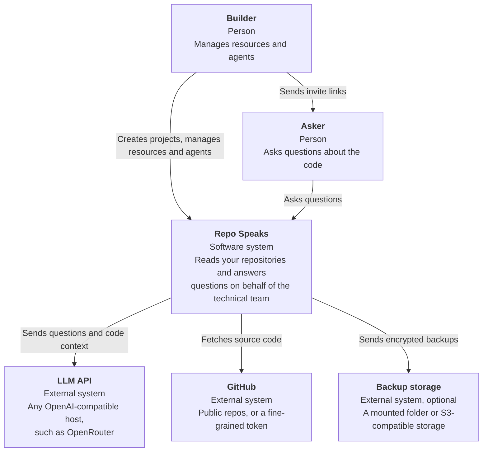
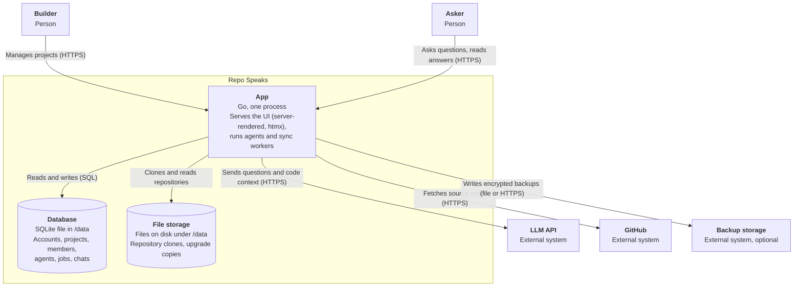
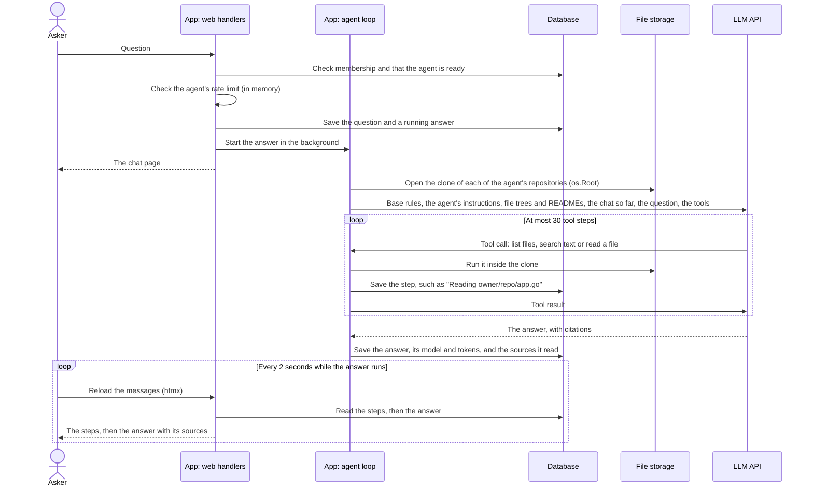
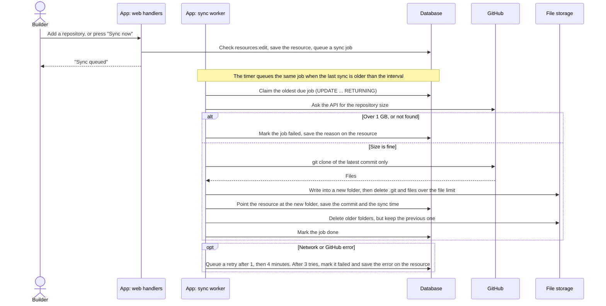
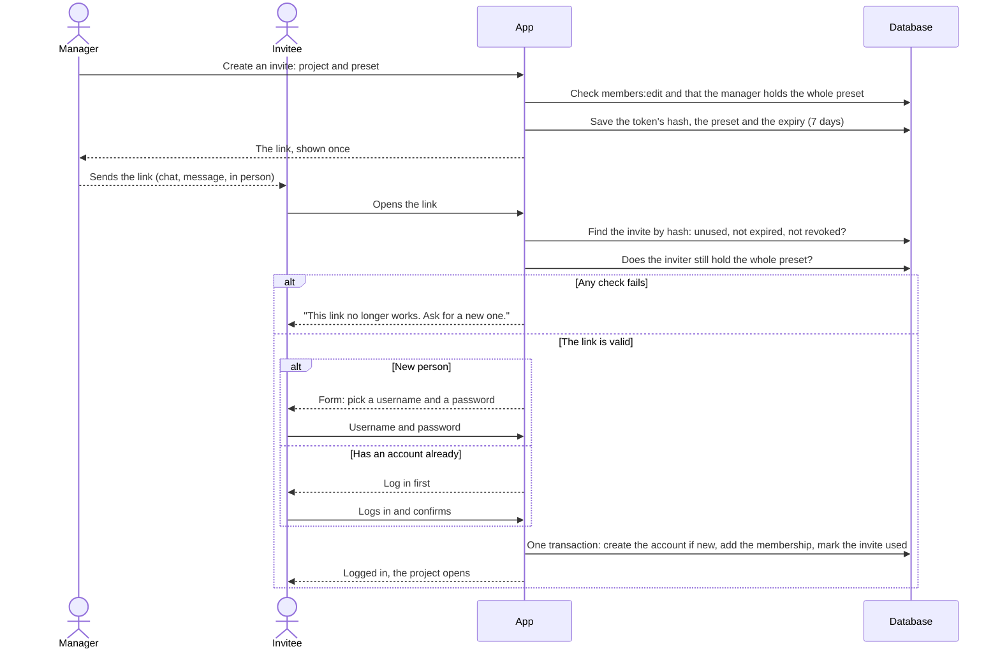
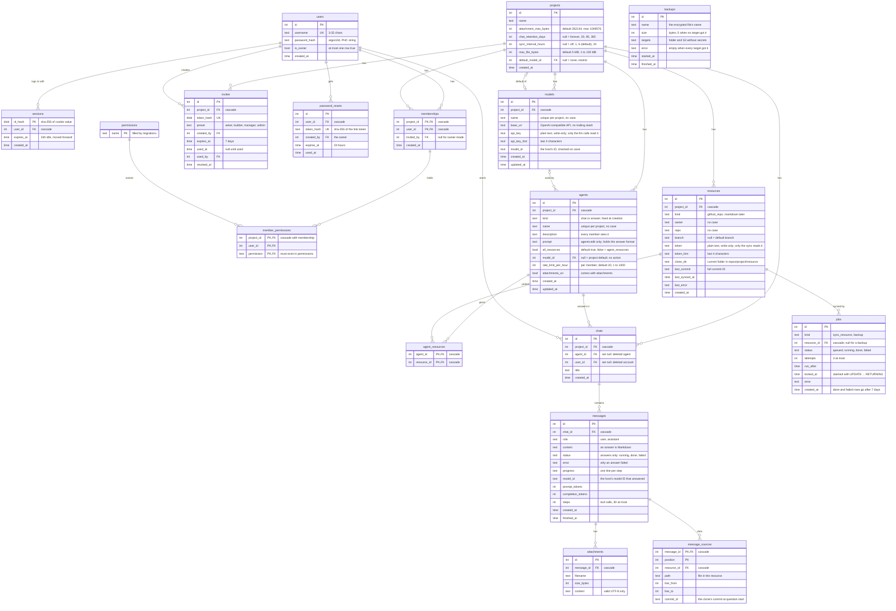
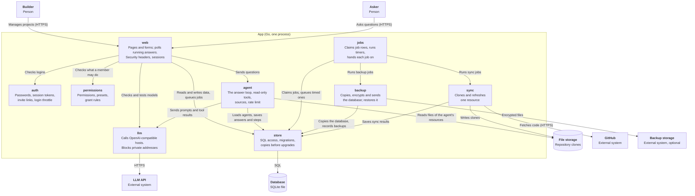

# Architecture

How Repo Speaks is built, at a high level. Terms follow the [glossary](docs/glossary.md).

> **Status:** early development. Boxes and choices marked *open* are not decided yet.

## Quality goals

In priority order. When two of them conflict, the higher one wins.

| # | Quality | Scenario |
| --- | --- | --- |
| 1 | Easy to self-host | A developer with Docker and an LLM API key gets the first answer within 15 minutes, running one container with one data folder. |
| 2 | Project isolation | Nothing from project A (no file, answer or source) ever reaches a member or agent of project B. Every route and every agent tool is covered by a test. |
| 3 | Answers you can check | Every answer lists the files it used. When the agent cannot find something, it says so instead of guessing. |

## System context



## Containers



- **One process.** The web UI, the agents and the sync workers run in one Go binary; sync workers and answers are goroutines.
- **Jobs are database rows**, so a restart does not lose a sync in progress. There is no Redis.
- **SQLite** is the database: a file in `/data`, used from inside the Go process through a pure-Go driver.
- **One data folder** (`/data`) holds the database, the clones (`/data/repos/<project>/<resource>`) and the copies made before a schema change (`/data/upgrades`). One volume to mount.
- **Backups are optional and on demand.** The owner presses "Back up now", or cron runs `repo-speaks backup`. A backup is the database only, copied with `VACUUM INTO`, encrypted with a passphrase (OpenPGP), and sent to a mounted folder, S3-compatible storage, or both. Clones are left out; a sync rebuilds them. The targets and the passphrase are environment settings, so the storage keys never sit in the database or in a backup.
- **Upgrades keep a copy.** Before a schema change, the app writes a copy of the database to `/data/upgrades` and keeps the newest 3. Schema changes only go forward, and an older version refuses a newer database.
- **Clone protection:** the repository size is checked before cloning (1 GB at most), only the latest commit is fetched, and files over a per-project limit (default 5 MB) are deleted from the clone.

## Main flow: an asker asks a question



- **Polling, not streaming.** The answer runs on the server's context, not the request's. The page asks for the messages every 2 seconds, so a reload loses nothing and no connection stays open.
- **Limits.** One answer may make 30 tool calls and run 5 minutes. At the step limit, the model gets one last call that asks it to answer with what it found. Four answers run at a time; more wait their turn.
- **A restart** stops running answers. On start, the server marks answers still running as failed, so the asker can ask again.
- **Sources** are the files the answer cites, kept only when the agent read them during the answer. Each stores the commit the clone had at question start, and links to GitHub at that commit.
- **No index.** The agent searches the clone with its tools. It gets the file tree and the README up front.

## Sync flow: a repository is brought up to date

A sync starts in three ways: a builder adds a repository, a builder presses "Sync now", or the project's timer fires (every 6 hours by default; off, 1, 6 or 24 hours). All three add the same job row.



- **One open job per resource.** Pressing "Sync now" twice does not start two syncs.
- **A new folder for every sync.** The resource points at a folder only once it is complete, so an agent reads either the old clone or the new one, never half of each. The previous folder stays until the next sync, because a question may still read it. A sync needs room for three clones at most.
- **The timer skips resources tried within the interval**, so a failing repository is not tried again every few minutes.
- **git runs boxed in.** The app builds the clone URL from checked names; git gets a fixed environment, speaks only https, writes symlinks as plain files, skips submodules, and is killed with its helpers after 10 minutes. The token reaches git only as an HTTP header through the environment.
- **The web handler only queues.** A slow clone never blocks a page.

## Invite flow: a new person joins a project



- **Only the hash is stored.** A copy of the database holds no working links.
- **Checked again on use.** A manager who lost their rights, or left, has no working links.
- **"Mark used" only succeeds once** (`UPDATE ... WHERE used_at IS NULL`). Two people opening the same link at once cannot both join.
- An invitee who is already a member sees "You are already a member", and the link stays unused.

## Backup flow: the owner presses "Back up now"

```mermaid
sequenceDiagram
    actor Owner
    participant Web as App: web handlers
    participant Worker as App: jobs worker
    participant DB as Database
    participant Data as Data folder
    participant Target as Backup storage

    Owner->>Web: Press "Back up now"
    Web->>DB: Check the owner, queue a backup job (one open at most)
    Web-->>Owner: "Backup queued"; the list reloads every 5 seconds
    Worker->>DB: Claim the job
    Worker->>DB: VACUUM INTO a temporary file in the data folder (0600)
    Worker->>Data: Encrypt it into a second temporary file, then remove the plain copy
    loop Each target
        Worker->>Target: Folder: write a temporary name, then rename. S3: upload
    end
    Worker->>Data: Remove the encrypted temporary file
    Worker->>DB: Record the backup: name, size, targets, error. Mark the job done or failed
```

- **The command does the same.** `repo-speaks backup` runs the same steps without a job, while the server runs, so cron can call it.
- **A failed target does not stop the others.** The record names each failed one. A failed backup is not tried again; the owner sees the error and can press the button again.
- **Errors never show a secret.** The passphrase and the S3 keys are removed from every error before it is saved or logged.
- **Restore runs with the server stopped.** `repo-speaks restore <file>` refuses while the database is open. It decrypts the backup next to the database, runs the integrity check, refuses a newer schema, then moves the current database aside and puts the backup in place.

## Entity relationships

Tables for phase 1. `attachments` is planned and not built yet.



- IDs are integers. Times are Unix seconds. Tables are SQLite `STRICT`.
- Deleting a project deletes everything in it.
- Chats stay when a member leaves, or an agent or account is deleted. Each project chooses how long chats live: forever (default), 30, 90 or 365 days.
- An answer agent's chat holds exactly one question and one answer. The app refuses a second question.
- Session IDs and link tokens are stored only as SHA-256 hashes.
- `member_permissions` references `permissions`, so the database rejects unknown names.
- A resource is unique per project, repository and branch; the default branch counts as one branch. A partial unique index allows one open (queued or running) job per resource. A second one allows one open job per kind among jobs without a resource, so there is one open backup at most.
- `backups` stands alone: a record of each backup this server made, for the Backups page. The backup settings are not in the database.
- A model's name is unique per project. The same model ID may appear twice, with other hosts or keys. Changing a model's base URL clears its key in the same update.
- The project's default model cannot be deleted. The app refuses first; the foreign key is `ON DELETE RESTRICT` in case a code path forgets.
- An agent may pick a model of its own; otherwise it uses the project's default. With neither, it is "not ready". A model an agent uses cannot be deleted either. The app refuses first and names the agents. The foreign key is `NO ACTION`, which SQLite checks at the end of the statement, so deleting a project still deletes its agents and models in any order.
- An agent with `all_resources` off reads only the resources in `agent_resources`. The app adds only resources of the agent's own project. A deleted resource drops out by cascade.
- The rate limit is stored on the agent. The app counts questions per member in memory, so a restart resets the counts.
- Only answers have a status. A chat has at most one running answer: a question waits until the last answer is done or failed.
- A source keeps the commit the answer read, so its link never shifts after a sync. Deleting the resource deletes its sources; the answer keeps its text.

## Components of the App

Zooming into the App container. Each component is one Go package under `internal/`.



- **Three entry points.** People come in through `web`. Timers and queued work run in `jobs`. Answers run in `agent`, in the background. `main.go` starts all three.
- **`web` never calls `sync`.** It queues a job row, so the database is the only link between them. A restart loses no work.
- **Only `store` knows SQL, and only `llm` talks to LLM hosts.** Neither uses anything else from the app.
- **`llm` speaks one API:** OpenAI-compatible chat completions with tools, so any host that speaks it works. It lists a host's models, checks a model ID on save, sends the Test request, and runs the calls of each answer.
- **`llm` guards the server.** A project admin sets a model's base URL, so the client refuses loopback, private, link-local, multicast and carrier-grade NAT addresses unless the operator allows them. The check runs in the dialer, on the address dialed, so a DNS change cannot get around it. It follows no redirects, ignores proxy settings, and caps time (30 seconds, or 2 minutes for a call of an answer) and reply sizes.
- **Where trust changes:** file content from a repository reaches the LLM. A file can carry instructions for the agent (prompt injection), so the agent's tools only read, and only inside the agent's resources. Every file access goes through an `os.Root` on the clone, so a symlink or a `..` cannot leave it. The model's answer is untrusted too: it renders without raw HTML, and its links show as text.
- **`agent` takes one thing from `sync`:** `ClonePath`, where a clone lives.
- **`backup` never sees a page.** The web handler queues a backup job and reads the records, like a sync. The page shows the targets without secrets.

## Code map

```
main.go              read config, wire packages, start the web server, the jobs loop and the agents;
                     the reset-link, backup and restore commands
internal/
  web/               HTTP handlers, middleware, templates, static files (embedded)
  auth/              passwords, sessions, invite links, login throttle
  permissions/       permissions, presets, Grant
  store/             SQLite access and migrations
  jobs/              the job loop and timers; hands each job to sync
  sync/              clone and refresh one resource
  backup/            encrypted backups to a folder or S3, and restore
  agent/             the answer loop, its read-only tools, sources, rate limit
  llm/               OpenAI-compatible client, base URL check, private address guard
  config/            settings from the environment
```

Built so far: every package above. Chat retention and attachments come later. Dependencies point one way: `web` and `jobs` use the others; `agent` uses `store`, `llm` and the clone path of `sync`; `store` and `llm` use nothing from the app. `jobs` takes the syncer and the backup service as small interfaces, and `main.go` passes it the real ones. `backup` uses `store` and `config`.

## Known risks

| Risk | Impact | Response |
| --- | --- | --- |
| A confident wrong answer | Askers cannot read code, so they cannot spot it | Sources under every answer; the agent says "not found" instead of guessing; managers can review chats (`chats:view`) |
| Data leaving its boundary | A file in a repository can carry instructions for the agent (prompt injection); attachments reach the LLM host; a bug could cross projects | Agent tools are read-only and scoped to the agent's resources; every file access goes through `os.Root`, so links cannot leave the clone; attachments are off by default per agent, with a warning; isolation tests (quality goal 2) |
| Prompt injection in the answer | A file tells the model to write a link that sends chat text to another site, or to show its instructions | The base rules say to ignore instructions in files and not to repeat the instructions; answers render without raw HTML, links show as text and images never load; only the app builds clickable source links. The model can still be misled, so the rules lower the risk but do not remove it |
| Cost running away | Agentic search can make many LLM calls for one question | A rate limit per member on each agent; 30 steps and 5 minutes per question; each answer records its model and tokens (totals come later) |
| A hostile repository | A repository or a name could try to read server files, reach other hosts, fill the disk or hang the worker | Checked names and an app-built URL; git with a fixed environment, https only, symlinks as plain files, no submodules; a size check before cloning; a timeout that kills git's process group |
| Tokens and keys at rest | A copy of the data folder holds every GitHub token and LLM API key in plain text, and so do the copies made before upgrades | Backups are encrypted with a passphrase (OpenPGP, AES-256), and the storage keys stay in the environment, out of every backup; tokens and keys are write-only in the UI and kept out of URLs, arguments, logs and errors; fine-grained tokens limit each to one repository, read-only; a model's key is cleared when its URL changes; the data folder and every copy are readable by the app only (0600) |
| Losing data | A disk dies, or an upgrade goes wrong | Optional encrypted backups off the disk, by button or by cron, to a folder or S3; a copy before each schema change, the newest 3 kept; an older version refuses a newer database; restore keeps the old database aside. A lost passphrase means lost backups, and the docs say so |
| A model URL that points inside | A project admin could make the server call internal systems or the cloud metadata address, and read the replies in an error | Private addresses are refused at connect time unless the operator sets `REPO_SPEAKS_ALLOW_PRIVATE_LLM`; no redirects, no proxy; errors show the status and at most 200 characters of the host's message |

## Open decisions

- How the owner resets their own password
